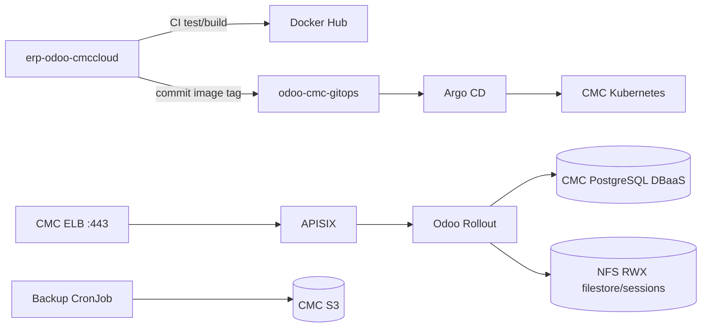

# Odoo CMC GitOps

Repository này là **nguồn trạng thái mong muốn duy nhất** cho Odoo trên CMC Cloud.
Repo ứng dụng `erp-odoo-cmccloud` chỉ kiểm thử, build và push image. CI không chạy
`kubectl apply` cho workload; sau khi publish thành công, CI chỉ commit tag
`sha-<commit>` vào `overlays/dev/kustomization.yaml`. Production nhận image đã kiểm thử
qua workflow promotion riêng rồi sync Argo CD. Hai môi trường cùng cluster, namespace
và node group riêng. Hướng dẫn hiện hành: [private multi-environment runbook](cmc/MULTI-ENV.md).

Entry point triển khai là **Actions → Deploy CMC environments → Run workflow → main**,
chọn `dev`, `prod` hoặc `both`. Workflow cấu hình Git, bootstrap, yêu cầu Argo sync và
kiểm tra đúng commit/image. `both` chạy Dev thành công rồi mới chạy Prod. Đây là deploy
image đã pin; phát hành image mới lên Prod dùng **Promote tested Dev images to Production**.
Chuẩn bị node groups/DB/Secrets và migration legacy theo runbook trước lần đầu.



## Cấu trúc

```text
bootstrap/                 AppProjects riêng và root, bootstrap có thể chạy lại
clusters/cmc/platform/     APISIX, Rollouts, KEDA, etcd, namespace ownership
clusters/cmc/dev/          Application odoo-dev, workflow-controlled overlays/dev
clusters/cmc/prod/         Application odoo-prod, sync qua workflow thủ công
clusters/cmc/legacy/       Application odoo-cmc giữ cho data migration
base/                      Workload Odoo dùng chung cho các môi trường
overlays/cmc-common/       Cấu hình CMC dùng chung, không chứa image pins
overlays/dev/              odoo-dev, node group Dev, port-forward qua bastion
overlays/prod/             odoo-prod, node group Prod, private ELB -> APISIX
overlays/cmc/              Legacy odoo-system, giữ cho migration
overlays/cmc-retired/      Opt-in dừng writers/route cũ, giữ dữ liệu
overlays/local/            Overlay Docker Desktop để thử nghiệm
overlays/http-scaling/     Scaler APISIX/Prometheus tùy chọn
infrastructure/            APISIX etcd
overlays/cmc-infrastructure/Desired state platform phụ trợ trên CMC
dr/                        Restore drill và recovery helper
scripts/                   Configure, promotion, Argo reconciliation và verification
tests/                     Boundary, schema và Helm tests
cmc/                       Runbook CMC và cấu hình preflight mẫu
```

## Ranh giới trách nhiệm

| Thành phần | Owner |
|---|---|
| Odoo source, addons, Dockerfiles, CI image | `erp-odoo-cmccloud` |
| Manifest, environment config, image version, Argo applications | repo này |
| Image artifact | Docker Hub, tag bất biến `sha-<git-sha>` |
| Deploy/reconcile/rollback | Argo CD từ Git history |
| Bootstrap Argo CD và runtime Secrets | workflow thủ công trên bastion |

CMC overlay dùng PostgreSQL DBaaS 16 qua Secret `odoo-db-connection`; không dựng
PostgreSQL trong cluster và không commit endpoint/credential vào Git. Filestore và
sessions vẫn cần NFS `ReadWriteMany`. Backup tạo snapshot trên PVC staging rồi upload lên
CMC S3; marker `_SUCCESS` được ghi cuối cùng. Production traffic chỉ đi qua CMC ELB
private TCP 443 đến APISIX TLS, sau đó APISIX route HTTP/WebSocket đến stable/canary.
Dev không có ELB/route ngoài; dùng proxy ClusterIP qua localhost port-forward.

## Kiểm tra offline

```bash
python -m pip install -r requirements-tools.txt
python validate.py
python -m unittest discover -s tests -v
python tests/validate_cloud_charts.py
kubectl kustomize overlays/dev >/dev/null
kubectl kustomize overlays/prod >/dev/null
kubectl kustomize clusters/cmc >/dev/null
```

Hướng dẫn điền GitHub Variables/Secrets, cấu hình CMC và thứ tự bootstrap nằm tại
[`cmc/MULTI-ENV.md`](cmc/MULTI-ENV.md). Workflow cấu hình thay placeholder không nhạy cảm;
bootstrap từ chối chạy nếu desired state deploy vẫn còn `REPLACE_`.
