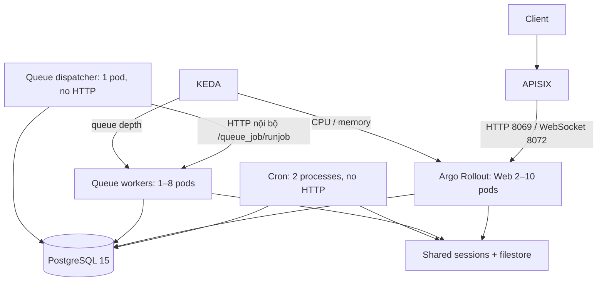

# Odoo 17 trên Kubernetes — Decomposed Monolith

**Triển khai CMC Cloud:** xem [hướng dẫn Argo CD trên CMC](cmc/README.md).
`deploy.ps1` chỉ dành cho local Docker Desktop. Trên CMC, GitHub Actions build
image và cập nhật Git; Argo CD là thành phần đồng bộ workload vào cluster.
Vẫn cần NFS RWX, domain/TLS và kubeconfig thực tế trước khi bootstrap.

Web, cron và hàng đợi dùng chung PostgreSQL để giữ giao dịch ACID. Sessions và filestore dùng chung PVC; Odoo vanilla đồng bộ bus qua PostgreSQL `pg_notify`.



Các manifest thực thi nằm trong `base/`; `k8s/kustomization.yaml` trỏ tới base, overlays chọn storage/scaler phù hợp.

## Thành phần đã triển khai

| Thành phần | Cấu hình |
|---|---|
| Web | Một Rollout duy nhất, 2 HTTP workers/pod; tắt cron và queue runner; probes `/web/health`. |
| Queue worker | 2 HTTP workers/pod (yêu cầu Odoo cho PDF), chỉ có Service nội bộ, tắt cron và queue runner. |
| Queue dispatcher | OCA jobrunner, `--no-http --workers=1`, kênh `root:8`, gửi job tới Service worker. |
| Cron | `--no-http --workers=2 --max-cron-threads=2`; cron khóa dòng bằng `SKIP LOCKED`. |
| APISIX | `odoo.local`, HTTP 8069, WebSocket 8072, upload 100 MiB, read/send timeout 600s. Chặn endpoint DB manager và queue job từ gateway. |
| Argo | stable/canary Services; điều phối cả HTTP và WebSocket theo 20% → 50% → 100%. |
| KEDA | Web theo CPU/RAM; worker theo pending/enqueued/started, giữ pod cho job đang chạy. |
| Storage | Base dùng RWX cho Odoo, backup và restore; overlay local dùng RWO trên Docker Desktop một node. |
| Secrets | Sinh ngẫu nhiên khi deploy, giữ lại khi chạy lại; không lưu password trong manifest. |
| DB init | Job cài base/web/queue_job trước khi app và scaler khởi động; đặt password admin đăng nhập cho DB mới. |
| Backup/restore | Snapshot DB + filestore nhất quán, SHA256, PVC riêng, restore vào DB/filestore riêng và kiểm tra file attachments. |

Image `k8s/image/Dockerfile` thêm OCA queue ở commit được ghim, giữ entrypoint chính thức của Odoo. Cài `queue_job` chỉ cung cấp cơ chế hàng đợi; nghiệp vụ cần gọi `with_delay()`/API OCA để tạo job. Báo cáo/PDF mặc định vẫn đồng bộ.

## Chạy trên Docker Desktop

Yêu cầu: Docker Desktop bật Kubernetes, context `docker-desktop`, kubectl, Helm 3, Python có PyYAML. Chạy từ bất kỳ thư mục nào:

```powershell
# Kiểm tra offline, không kết nối hay sửa cluster
.\k8s\deploy.ps1 -ValidateOnly
# Build hai image, cài controllers, khởi tạo DB rồi triển khai
.\k8s\deploy.ps1
```

Script luôn truyền context rõ ràng, không đổi current-context. Nếu không có `docker-desktop`, script dừng trước mọi thay đổi cluster. Kiểm tra lỗi sau từng lệnh; không báo thành công nếu controller, DB init hoặc scaler chưa sẵn sàng.

Helm ghim APISIX chart 2.10.0 (ingress-controller 0.14.0), Argo 2.43.6, KEDA 2.18.0, metrics-server 3.12.2. APISIX dùng etcd riêng để tránh dependency image Bitnami cũ. `--kubelet-insecure-tls` chỉ dành cho metrics-server local. Các phiên bản này phục vụ bộ lab tương thích; cần đánh giá/nâng phiên bản và TLS trước khi đưa lên cloud.

Thêm `127.0.0.1 odoo.local` vào file hosts. Docker Desktop dùng cluster nhiều node có thể không publish NodePort trực tiếp ra Windows, vì vậy mở một terminal riêng và giữ terminal này chạy:

```powershell
.\k8s\port-forward.ps1
```

Sau đó mở **http://odoo.local:30080**. Port-forward đi qua APISIX và hỗ trợ cả HTTP lẫn WebSocket. Có thể kiểm tra trước bằng:

```powershell
curl.exe -H "Host: odoo.local" http://127.0.0.1:30080/web/health
```

Kết quả mong đợi là `{"status": "pass"}`.

Overlay local đặt `X-Forwarded-Host` thành `odoo.local:30080` để các redirect do Odoo sinh ra giữ đúng port. Không mở `http://odoo.local` thiếu port vì cổng 80 có thể thuộc về một dịch vụ Windows khác.

Đăng nhập bằng `admin`; lấy password khởi tạo (sau khi đổi trong UI, Secret không tự cập nhật):

```powershell
$Encoded = kubectl --context docker-desktop -n odoo-system get secret odoo-secrets -o 'jsonpath={.data.ADMIN_LOGIN_PASSWORD}'
[Text.Encoding]::UTF8.GetString([Convert]::FromBase64String($Encoded))
```

`ADMIN_PASSWORD` là master password quản lý DB; khác password đăng nhập. `list_db=False` và dbfilter cố định khóa DB manager. Không thay password DB trong Secret của một PVC PostgreSQL đã khởi tạo mà không đổi password role tương ứng.

Nếu đã triển khai bộ cũ, phải lên lịch chuyển đổi: giữ PVC, dừng Deployment web cũ trước khi tạo Rollout để tránh selector chồng lấn; loại bỏ Redis/Ingress NGINX và Secret cũ sau khi kiểm tra. Script mới không tự xóa workload/PVC hiện có.

## Bộ nhớ và kết nối

Giới hạn Odoo: soft 768 MiB, hard 1 GiB mỗi worker. Web/queue worker 2.5 GiB; dispatcher 1.5 GiB; cron **2.5 GiB** vì có hai cron processes. Giới hạn này là ngân sách tối thiểu cho lab; đo thực tế để tăng overhead khi có module/job nặng.

`db_maxconn=4` và `db_maxconn_gevent=4`. Tại 10 web pods + 20% canary surge, 8 queue pods, 2 cron processes và 1 dispatcher, ngân sách pool là **252**; cộng 32 kết nối dự phòng thành **284/300**. Master đóng pool kế thừa trước khi fork. Nếu tăng worker, replica hoặc surge phải tính lại ngân sách; có thể dùng PgBouncer sau khi kiểm chứng tương thích.

## HTTP request scaling tùy chọn

`overlays/http-scaling` bổ sung scaler Prometheus cho APISIX. Cần có Prometheus thực sự scrape APISIX port 9091, endpoint `/apisix/prometheus/metrics`; cấu hình tham khảo `helm/prometheus-scrape.yaml`. Plugin bật `prefer_name=true` để query theo tên route. Đổi serverAddress/query theo hệ thống monitoring và kiểm tra query trả về số trước khi apply overlay. Mặc định local dùng CPU/RAM và không phụ thuộc Prometheus.

## Backup và restore drill

CronJob chạy **02:00 giờ Việt Nam**, tạo snapshot trong `odoo-backup-pvc`, giữ các bộ hoàn chỉnh bảy ngày. Backup lấy lock, lưu trạng thái phục hồi, pause KEDA, scale web/worker/cron/dispatcher về 0, chờ tất cả tiến trình ghi thoát rồi dump DB và nén filestore. Có **khoảng ngừng dịch vụ** trong mỗi backup; không deploy/canary/DB init/ghi dữ liệu ngoài Odoo cùng lúc.

```powershell
kubectl --context docker-desktop -n odoo-system create job --from=cronjob/odoo-disaster-recovery-backup manual-backup-demo
kubectl --context docker-desktop -n odoo-system logs -f job/manual-backup-demo
# Dùng timestamp UTC của bộ backup xuất hiện trong log
.\k8s\dr\restore-drill.ps1 -BackupSet 20261013T190000Z
```

Restore kiểm tra SHA256, tạo DB mới `odoo17_restore_drill`, restore filestore vào PVC riêng và kiểm tra checksum từng attachment. Dùng `-Database odoo17_restore_drill_02` cho lần diễn tập tiếp theo; không ghi đè DB/filestore đã tồn tại. Script giữ dữ liệu drill để kiểm tra, không tự xóa.

Nếu backup bị SIGTERM/lỗi thông thường, `finally` khôi phục replicas và KEDA. Nếu Pod/node bị kill cứng hoặc API lỗi khi resume, lock `odoo-backup-lock` còn trạng thái cần khôi phục. Xác nhận Job/Pod backup đã dừng rồi chạy `dr/recover-backup.ps1`. Không xóa lock khi chưa khôi phục workload.

PVC backup tách DB nhưng vẫn ở cùng cluster, nên cần sao chép các bộ backup ra object storage hoặc failure domain độc lập để đáp ứng DR cấp cloud. Restore drill chưa thay thế bài thử phục hồi toàn bộ cluster.

## Kiểm tra và demo

```powershell
python .\k8s\validate.py
kubectl kustomize .\k8s
kubectl kustomize .\k8s\overlays\local
docker compose config --quiet
kubectl --context docker-desktop -n odoo-system get rollouts,scaledobjects,pods
kubectl --context docker-desktop -n odoo-system logs deployment/odoo-queue-runner
```

Chạy smoke test đăng nhập, attachment, WebSocket, tạo job qua OCA và canary bằng image có tag mới sau khi cluster local sẵn sàng. Khi demo self-healing chỉ xóa **một** web pod; request đang xử lý/WebSocket trên pod đó có thể bị ngắt rồi reconnect, không bảo đảm mọi request đều không gián đoạn. Canary chỉ dùng cho code tương thích cùng DB schema; không tự chạy `-u all` khi nâng image.
