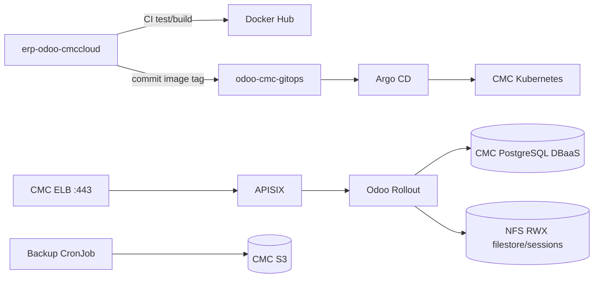

# Odoo CMC GitOps

Repository này là **nguồn trạng thái mong muốn duy nhất** cho Odoo trên CMC Cloud.
Repo ứng dụng `erp-odoo-cmccloud` chỉ kiểm thử, build và push image. CI không chạy
`kubectl apply` cho workload; sau khi publish thành công, CI chỉ commit tag
`sha-<commit>` vào `overlays/cmc/kustomization.yaml`. Argo CD đọc commit đó và
reconcile cluster.



## Cấu trúc

```text
bootstrap/                 AppProject và root Application, apply đúng một lần
clusters/cmc/              App-of-apps: APISIX, Rollouts, KEDA, platform, Odoo
base/                      Workload Odoo dùng chung cho các môi trường
overlays/cmc/              Desired state CMC; image tag được CI cập nhật tại đây
overlays/local/            Overlay Docker Desktop để thử nghiệm
overlays/http-scaling/     Scaler APISIX/Prometheus tùy chọn
infrastructure/            APISIX etcd
overlays/cmc-infrastructure/Desired state platform phụ trợ trên CMC
dr/                        Restore drill và recovery helper
scripts/                   Công cụ promotion image
tests/                     Boundary, schema và Helm tests
cmc/                       Runbook CMC và cấu hình preflight mẫu
```

## Ranh giới trách nhiệm

| Thành phần | Owner |
|---|---|
| Odoo source, addons, Dockerfiles, CI image | `erp-odoo-cmccloud` |
| Manifest, environment config, image version, Argo applications | repo này |
| Image artifact | Docker Hub, tag bất biến `sha-<git-sha>` |
| Deploy/reconcile/rollback | Argo CD từ Git history |
| Bootstrap Argo CD và runtime Secrets | workflow thủ công trên bastion |

CMC overlay dùng PostgreSQL DBaaS 16 qua Secret `odoo-db-connection`; không dựng
PostgreSQL trong cluster và không commit endpoint/credential vào Git. Filestore và
sessions vẫn cần NFS `ReadWriteMany`. Backup tạo snapshot trên PVC staging rồi upload lên
CMC S3; marker `_SUCCESS` được ghi cuối cùng. Public traffic chỉ đi qua CMC ELB
HTTPS đến APISIX, sau đó APISIX route HTTP/WebSocket đến stable/canary Services.

## Kiểm tra offline

```bash
python -m pip install -r requirements-tools.txt
python validate.py
python -m unittest discover -s tests -v
python tests/validate_cloud_charts.py
kubectl kustomize overlays/cmc >/dev/null
kubectl kustomize clusters/cmc >/dev/null
```

Hướng dẫn điền GitHub Variables/Secrets, cấu hình CMC và thứ tự bootstrap nằm tại
[`cmc/README.md`](cmc/README.md). Workflow cấu hình thay placeholder không nhạy cảm;
bootstrap từ chối chạy nếu desired state deploy vẫn còn `REPLACE_`.
