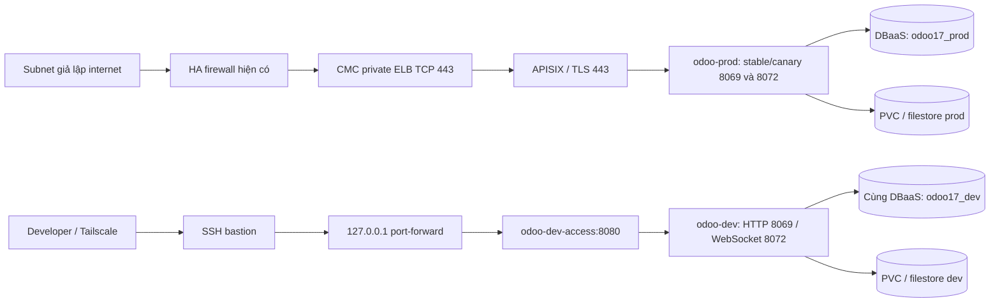

# Odoo Dev/Production trong private VPC

Đây là runbook hiện hành. Firewall HA và DNS đã thuộc phạm vi người vận hành;
các bước dưới đây không cấu hình firewall, subnet routes hay Tailscale.

## Luồng truy cập



Dev **không cần ELB riêng** khi chỉ test bằng VPN/bastion. Một proxy NGINX nội bộ,
không phải ingress controller, gom HTTP/WebSocket vào một cổng port-forward.
Forward trực tiếp 8069 chỉ phù hợp kiểm tra HTTP, không kiểm tra đầy đủ bus/WebSocket.
Dev không có ApisixRoute/ApisixTls; Host header Dev gửi vào ELB không mở được Dev.
ELB dùng TCP passthrough 443, TLS kết thúc tại APISIX. Domain/certificate do bạn cung cấp.

## 1. Chuẩn bị node groups

Trên CMC tạo hai worker node groups `odoo-dev` và `odoo-prod` trong private subnet đã có.
Không gán public IP. File [node-groups.example.yaml](node-groups.example.yaml) là hợp đồng
cấu hình, **không chạy kubectl apply file này**. CMC node group không phải đối tượng Node
có thể tạo bằng manifest Kubernetes. Chưa có CMC API/IaC credentials trong phạm vi này.

| Group | Nodes | Label | Taint |
|---|---:|---|---|
| Dev | ít nhất 1 | `odoo.cmc/environment=dev` | `odoo.cmc/environment=dev:NoSchedule` |
| Prod | ít nhất 2, khuyến nghị 3 | `odoo.cmc/environment=prod` | `odoo.cmc/environment=prod:NoSchedule` |
| Platform hiện tại | giữ riêng, đủ cho APISIX/etcd/controllers | không dùng label Dev/Prod | giữ untainted |

Ưu tiên đặt label/taint trong cấu hình node group để node mới do autoscaler hoặc
replacement nhận đúng cấu hình. Nếu portal không hỗ trợ, áp dụng sau khi node đăng ký
và lặp lại cho mọi node mới. Trên bastion, thay đúng tên node đã kiểm tra:

```bash
export CMC_CONTEXT='k8s-odoo-admin@k8s-odoo'
kubectl --context "$CMC_CONTEXT" get nodes -o wide
kubectl --context "$CMC_CONTEXT" label node DEV_NODE odoo.cmc/environment=dev
kubectl --context "$CMC_CONTEXT" taint node DEV_NODE odoo.cmc/environment=dev:NoSchedule
kubectl --context "$CMC_CONTEXT" label node PROD_NODE_1 PROD_NODE_2 odoo.cmc/environment=prod
kubectl --context "$CMC_CONTEXT" taint node PROD_NODE_1 PROD_NODE_2 odoo.cmc/environment=prod:NoSchedule
kubectl --context "$CMC_CONTEXT" get nodes -L odoo.cmc/environment
```

Không relabel/taint toàn bộ nhóm hiện tại: platform controllers vẫn cần chỗ chạy.
Taint `NoSchedule` không đuổi pod đã chạy; affinity `IgnoredDuringExecution` cũng không.
Kiểm tra CNI, kube-proxy, CSI node plugin có toleration đúng trên các node mới.

Required node affinity giữ pod đúng nhóm; toleration chỉ cho phép vượt taint, không tự
chọn node. Web/worker có preferred anti-affinity và web có topology spread theo hostname.
Dispatcher có preferred affinity với worker cùng namespace. Các preference không chặn
canary surge khi số pod lớn hơn số node. Không có node đúng nhóm thì pod Pending.

Sizing ban đầu: Dev có thể bắt đầu 4 vCPU/8 GiB, Prod 2–3 node 4 vCPU/16 GiB,
nhưng phải tính allocatable, CNI/CSI overhead và khả năng chịu mất node thực tế.
ResourceQuota là trần namespace, không cung cấp tài nguyên cho node group.

## 2. Database và dữ liệu riêng

Cùng DBaaS PostgreSQL 16, database `odoo17_dev` và `odoo17_prod`, role khác nhau.
DBA tạo database trước; Odoo chỉ khởi tạo schema/module trong database đã cấp.
Ví dụ SQL cho **database mới** (chạy bằng tài khoản DBA, đặt password qua `\password`
hoặc secret manager; không commit password):

```sql
CREATE ROLE odoo_dev LOGIN NOSUPERUSER NOCREATEDB NOCREATEROLE NOREPLICATION NOBYPASSRLS;
CREATE ROLE odoo_prod LOGIN NOSUPERUSER NOCREATEDB NOCREATEROLE NOREPLICATION NOBYPASSRLS;
CREATE DATABASE odoo17_dev OWNER odoo_dev;
CREATE DATABASE odoo17_prod OWNER odoo_prod;
REVOKE ALL ON DATABASE odoo17_dev FROM PUBLIC;
REVOKE ALL ON DATABASE odoo17_prod FROM PUBLIC;
GRANT CONNECT, TEMPORARY ON DATABASE odoo17_dev TO odoo_dev;
GRANT CONNECT, TEMPORARY ON DATABASE odoo17_prod TO odoo_prod;
```

Không chạy `CREATE DATABASE` nếu Production đã tồn tại. Với DB cũ, kiểm tra owner,
object ownership, grants và role membership rồi chuyển quyền theo migration DBA;
không đổi owner hàng loạt hoặc phục hồi đè dữ liệu chưa backup. Hai role không được
member của nhau hoặc của role đặc quyền. Giữ quyền CONNECT database `postgres` phục vụ
init helper hiện tại; quyền này không cấp CONNECT database ứng dụng khác.

Kiểm tra bằng mỗi login thật: kết nối DB đúng phải thành công; kết nối DB môi trường
khác phải thất bại. Bootstrap kiểm tra PostgreSQL 16, đúng DB, không superuser/createdb/
createrole/replication/bypassrls, và `has_database_privilege(..., peer_db, 'CONNECT') = false`.
Hai DB phải tồn tại trước khi bootstrap. Không dựa vào dbfilter để bảo vệ DB chéo.

Ngân sách chung: Prod web max 8 + 2 surge, queue max 4 = 180; Dev web max 2 + 1 surge,
queue max 1 = 60; reserve 32 => **272/300**. Cron/runner Recreate, queue `maxSurge: 0`
giữ giới hạn này. Kiểm tra `SHOW max_connections` >=300 và các client khác còn đủ reserve.
Đây là budget cấu hình, phải quan sát `pg_stat_activity` khi rollout/terminating pod thực tế.
Legacy writers phải dừng trước khi Prod mới dùng chung DB.

Mỗi namespace có 3 PVC RWX riêng; NFS provisioner phải tạo PV và export subdirectory
khác nhau. Không trỏ hai claim vào cùng thư mục. UID/GID/fsGroup 101 không đổi.
S3 prefix là `odoo/dev/backups` / `odoo/prod/backups`; lịch backup còn suspended.
Restore drill cần tài khoản DBA/restore có quyền riêng trong namespace đích; runtime
role NOCREATEDB không được dùng để tự tạo DB restore. Chuẩn bị DB phục hồi độc lập và
kiểm tra tool restore trước khi chạy; không nâng quyền runtime role chỉ để chạy drill.

## 3. GitHub configuration và bootstrap

Tạo GitHub Environments `odoo-dev`, `odoo-prod` trong **GitOps repo**, gán secrets/vars
theo bảng. Khuyến nghị required reviewers cho environment Prod nếu gói GitHub hỗ trợ.
Giới hạn quyền sửa GitOps repo/main và quyền Argo CD theo vai trò vận hành; RBAC developer
trong Kubernetes không bảo vệ Prod nếu cùng người dùng có quyền sửa desired state Prod.

| Biến/secret | Dev | Prod |
|---|---|---|
| `CMC_POSTGRES_HOST`, `CMC_POSTGRES_PORT` | cùng endpoint private | cùng endpoint private |
| `CMC_POSTGRES_DATABASE` (variable) | `odoo17_dev` | `odoo17_prod` |
| `CMC_POSTGRES_USER`, `CMC_POSTGRES_PASSWORD` (secrets) | role Dev | role Prod |
| `CMC_POSTGRES_SSLMODE` | policy DBaaS thực tế | policy DBaaS thực tế |
| `CMC_KUBE_CONTEXT` | cùng context bastion | cùng context bastion |
| `DOCKERHUB_USERNAME`, `DOCKERHUB_TOKEN` | pull credential | pull credential |
| `CMC_TLS_CERTIFICATE`, `CMC_TLS_PRIVATE_KEY` | không cần | certificate của hostname local |
| `ODOO_DOMAIN` | không cần cho port-forward | hostname local của Prod |

Các variable dùng workflow Configure ở cấp repo: `ODOO_DOMAIN`, `CMC_RWX_STORAGE_CLASS`
(mặc định nfs-csi), `CMC_BLOCK_STORAGE_CLASS`, `CMC_ELB_FLAVOR_ID` theo region đang dùng.
Không tự lấy flavor HCM trong lab nếu chưa đối chiếu region/flavor hiện tại.

Chạy Configure CMC desired state để thay placeholder flavor trong Git. Script sửa
`overlays/cmc-common` (domain/storage chung) và APISIX private class. Không tạo DNS.
Shared base không chứa image pins để promotion Dev/Prod không bị image transformer
ở base ghi đè. `overlays/cmc` chỉ giữ image phiên bản cũ cho migration.

Runner cần Linux x64, `python3-venv`, `kubectl`, Helm, OpenSSL và kubeconfig đã mount
tại `$HOME/.kube/config`; không tạo GitHub kubeconfig secret. Workflow dùng Python venv
riêng thay vì cài pip vào Python hệ thống. Metrics Server API phải Available. Runner
cần phân giải hostname Prod, truy cập private ELB và tin cậy CA ký certificate local
(cài CA vào trust store của runner trước); verification không bỏ qua TLS bằng `-k`.

Thứ tự cho lần deploy đầu hoặc chạy lại:

1. Chuẩn bị groups, cả hai DB/roles, GitHub environment settings, RWX, private registry access.
2. Commit/push GitOps changes và app CI changes sau khi review; nếu cluster đang chạy,
   làm theo phần migration trước khi sync Production. Không chạy workflow cũ trên checkout cũ.
3. Chọn **Actions → Deploy CMC environments → Run workflow → main**, chọn `dev`,
   `prod` hoặc `both`. `both` deploy/verify Dev xong mới bắt đầu Prod; không copy image
   Dev sang Prod. Mỗi môi trường dùng image pins đang có trong overlay của nó.
4. Workflow Configure commit non-secret settings nếu cần và truyền **SHA commit sau
   cấu hình** cho bootstrap. Bootstrap kiểm tra inputs, node group/metrics, legacy đã
   dừng, tạo Secrets, kiểm tra RWX UID101 và DBaaS, rồi đăng ký ba AppProjects và root.
5. Workflow yêu cầu Argo sync theo thứ tự root → namespaces → etcd/infrastructure →
   Rollouts → KEDA → APISIX → `odoo-<environment>`. Prod vẫn **không có automated sync**;
   Dev cũng dùng explicit sync để lần publish GitOps đầu tiên không chạy workload trước
   khi Secrets/node groups sẵn sàng. Lần bấm workflow là hành động sync có kiểm soát.
6. Chỉ báo thành công khi đúng revision Git/chart, đúng Application source/project/
   namespace, workload đã observe generation mới, actual pods đúng image và Ready,
   KEDA Ready, pod đúng node group và health HTTP/DB server pass qua entry point.

Không dùng **Re-run jobs** của run cũ để lấy workflow mới: hãy tạo **Run workflow mới
trên main** sau khi code được push. Nếu main tiến lên trong lúc chờ deploy, workflow
từ chối triển khai revision đã cũ; tạo run mới trên main. Workflow không tự tạo node
group/DB và không tự chuyển dữ liệu legacy. Cả Dev lẫn Prod đều dừng nếu legacy writers
còn chạy để giữ connection budget và tránh chạy hai stack với dữ liệu không nhất quán.

Chạy lại với cùng runtime Secrets không restart pod đã được xác nhận thành công.
Namespace lưu hash của bộ Secrets đã nghiệm thu; nếu run trước thất bại giữa cập nhật
Secrets và restart/verify, lần sau vẫn nhận diện cần restart. Khi rotate DB password,
giữ credential cũ còn hiệu lực trong thời gian chuyển đổi hoặc có maintenance window;
không thu hồi credential đang dùng giữa một rollout chưa hoàn tất.

Namespace được platform Application `odoo-environments` quản lý với Prune=false/Delete=false.
AppProject Dev/Prod chỉ cho namespace tương ứng, không cho cluster resources.
Bootstrap không đưa credential vào Git. Secret trùng tên ở hai namespace vẫn là đối tượng riêng.
Argo CD server vẫn ClusterIP; truy cập quản trị qua bastion như hiện tại.

## 4. Developer access

Trên bastion với kubeconfig của developer (identity/group `odoo-developers` do cluster
auth cấp, không chia sẻ kubeconfig admin):

```bash
kubectl --context "$CMC_CONTEXT" -n odoo-dev port-forward \
  --address 127.0.0.1 svc/odoo-dev-access 18069:8080
```

Từ máy cá nhân đã có Tailscale, mở terminal khác:

```bash
ssh -N -L 18069:127.0.0.1:18069 BASTION_USER@BASTION_PRIVATE_OR_TAILSCALE_IP
```

Mở `http://127.0.0.1:18069`. Không bind `0.0.0.0` trên bastion. Session forward cần
chạy lại nếu proxy pod thay đổi. Role cho đọc pod/log/service và port-forward trong Dev;
Kubernetes RBAC không giới hạn theo label động của pod, nên developer có thể forward
pod khác trong Dev. Role không cho đọc Secret, exec, tạo/sửa workload, Node hay Prod.
Không gán thêm RoleBinding rộng hơn cho cùng identity nếu cần giữ ranh giới này.

## 5. Chuyển từ odoo-system sang odoo-prod

`odoo-cmc` cũ được giữ đăng ký, manual sync và không có cascade-delete finalizer.
`odoo-prod` cũng manual; không đổi destination của Application cũ. Root sync có thể
reconcile APISIX thành ELB private ngay khi đủ annotation; kiểm tra thời điểm mở entry point.

1. Ghi nhận revision cũ, DB endpoint/name/owner, PVC/PV/export, image, số replica và
   backup nhất quán DB + filestore. Giữ lại Secret admin cũ, không in secret ra log.
2. Trong maintenance window, sửa `clusters/cmc/legacy/application.yaml` duy nhất phần
   `spec.source.path` thành `overlays/cmc-retired`, commit/push; sync root rồi sync
   legacy `odoo-cmc` **có prune**. Overlay này vẫn giữ namespace/PVC/config/RBAC,
   scale writer về 0, pause KEDA, suspend backup, bỏ init Job và route/TLS legacy.
   Prune ở bước này cần để route cũ thực sự bị gỡ; không delete Application hay namespace.
3. Đợi tất cả Odoo legacy pod đã kết thúc và kiểm tra kết nối DB trước khi chụp bản
   cuối/copy. Copy `/var/lib/odoo/filestore/<db>` và session nếu cần sang **PVC prod mới**,
   giữ ownership 101. Nếu giữ DB prod hiện tại thì chỉ chuyển filestore, không restore đè DB.
   Dùng công cụ backup/NFS/DBA phù hợp hạ tầng thực tế; chưa có snapshot/export ID để tự chạy.
4. Kiểm tra PV/export prod khác Dev và legacy, kiểm tra checksum và quyền đọc/ghi;
   chuẩn bị Secret admin Prod từ giá trị đã bảo quản. Bootstrap Prod kiểm tra DB/RWX.
5. Chạy Deploy CMC environments chọn `prod` để bootstrap, sync và verify. Xác nhận chỉ một cron và một dispatcher Production, image đúng,
   không còn route legacy cùng hostname. ELB -> APISIX -> Prod, TLS và login/upload/WebSocket pass.
6. Giữ dữ liệu/namespace cũ trong thời gian rollback; xóa chúng là bước quản trị sau nghiệm thu.

Rollback trước khi có ghi mới: dừng Prod bằng desired state, kiểm tra không còn writer,
khôi phục desired state legacy và route rồi sync. Sau khi có ghi mới hoặc schema đổi,
phải đồng bộ/restore DB + filestore về cùng thời điểm trước khi chạy legacy; chỉ revert Git
không đảm bảo dữ liệu đúng. Không chạy đồng thời hai stack trên cùng database với hai filestore.

## 6. Release và kiểm chứng

App CI build/test/push immutable images và chỉ update `overlays/dev`. Sau Dev acceptance,
workflow Promote Production nhận exact `sha-*`, copy hai image đã kiểm thử sang Prod,
từ chối nếu Dev đã đổi tag; không rebuild. Workflow commit rồi gọi bootstrap/sync/verify
Prod trong cùng lần chạy, qua GitHub Environment `odoo-prod`. Acceptance tag trên Dev
vẫn do người phát hành xác nhận trước khi bấm promotion.

App CI chỉ publish từ source main còn hiện hành, không ghi đè tag `sha-*` đã tồn tại;
run lại sẽ pull/smoke-test artifact hiện có. Nếu lỗi sau push image nhưng trước GitOps
commit, có thể chạy lại cùng source SHA khi nó vẫn là main. Git push retry tối đa ba lần
với rebase và validate; conflict thật hoặc thiếu quyền write phải được xử lý, không force.
Push bằng `GITHUB_TOKEN` không cần kích hoạt workflow phụ: Configure/Promote tự validate
và caller tiếp tục deploy. App CI dùng `GITOPS_PAT` có Contents read/write trên GitOps repo.

Nếu bật `CMC_AUTO_DEPLOY_DEV=true`, app CI gửi `deploy-dev-release` và workflow Deploy
sync/verify đúng tag Dev. Khi tắt, người vận hành bấm Deploy chọn Dev. Workflow **Verify
CMC reconciliation** chỉ đọc/kiểm tra; không sync. Release image mới: app CI → Deploy
Dev → Dev acceptance → Promote tested Dev images to Production.
Deploy lại cấu hình/image hiện tại: Deploy CMC environments → chọn môi trường.

```bash
python validate.py
python -m unittest discover -s tests -v
python tests/validate_cloud_charts.py
python scripts/environment.py preflight --environment dev --context "$CMC_CONTEXT"
python scripts/environment.py preflight --environment prod --context "$CMC_CONTEXT"
python scripts/verify_private_elb.py --context "$CMC_CONTEXT"
```

Runtime acceptance cần kiểm tra thêm:

- CNI enforce NetworkPolicy: direct Dev pod -> Prod Service và chiều ngược lại phải timeout
  với probe giới hạn thời gian. Policy ingress không lọc SQL đến DBaaS ngoài cluster;
  SQL isolation do role/grants đảm nhiệm. APISIX là entry point của Prod nên client có quyền
  mạng tới ELB vẫn có thể truy cập Prod theo cơ chế đăng nhập Odoo; namespace không thay auth.
- `kubectl auth can-i` bằng identity Dev thật: port-forward Dev yes, Secrets/exec/Prod no.
- RWX cross-node: hai pod trên hai node Prod đọc/ghi cùng marker; bootstrap một pod chỉ
  xác nhận UID101 ghi được, chưa chứng minh RWX cross-node hay HA NFS.
- ELB status RFC1918, chỉ 443, không public/floating IP trong CMC portal (Kubernetes status
  không chứng minh sạch orphan cloud resources). Subnet giả lập internet truy cập Prod pass.
- HTTP/login, upload gần 100 MiB, timeout job, WebSocket handshake/bus, canary health analysis,
  KEDA scale, node drain/failover, connection budget thực đo và backup/restore drill.

Các lệnh render không chứng minh live deployment. Workspace hiện không truy cập được private
API; node groups chưa tạo và credential từng môi trường chưa có. Không tuyên bố đã nghiệm thu.

## Tham chiếu

- [Lab CMC, nhánh có affinity](https://github.com/hgiang25/hcm3-k8s-lab/blob/trinh-v2/k8s/api-gateway/deployment.yaml)
- [App CI đa môi trường](https://github.com/hgiang25/aws-eks-gitops-platform/blob/main/.github/workflows/gitops-ci.yml)
- [Dev/Prod GitOps overlays](https://github.com/hgiang25/k8s-gitops/tree/main/apps)
- [CMC private ELB annotation](https://cmccloud.vn/document/Kubernetes/huong-dan/tao-service-cho-cum-k8s-voi-dich-vu-elastic-load-balancer)
